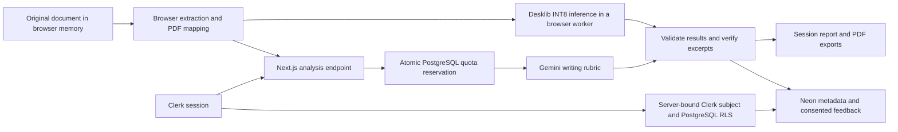
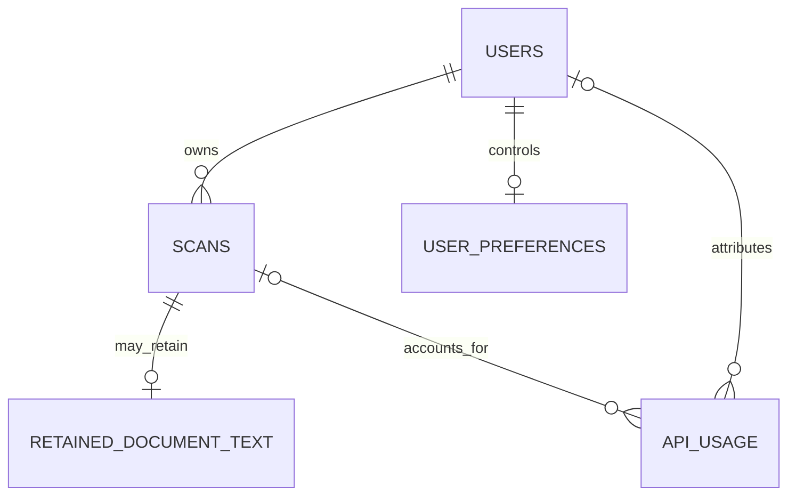

# Paper Checker

Paper Checker is an open-source workspace for AI writing detection and academic writing review. It combines a browser-generated Desklib INT8 pilot estimate with an independent Gemini writing rubric. The landing page contains a labeled interactive sample. Authenticated reports use live provider results or show provider failures.

## What you can do

- Analyze PDF, DOCX, TXT and pasted text with one submission.
- Review original PDF pages or formatted Word documents beside writing scores, verified excerpts and revision suggestions.
- Download summary reports and, when the matching PDF is present in memory, a copy with coordinate-mapped highlights.
- Search, filter, delete and compare private scans. Opt in to retaining extracted text and detailed feedback.
- Monitor provider usage, configured quotas and application statistics through server-authorized administration pages.

## Screenshots

Run the application and visit `/` for the interactive sample report. Capture screenshots of the authenticated workspace with your own test documents after configuring the integrations. No authenticated screenshots were captured during implementation.

## Stack

Next.js App Router, strict TypeScript, Tailwind CSS, shadcn-style Radix/CVA buttons, Lucide, Framer Motion through Motion for React, next-themes, Clerk, Neon PostgreSQL, Drizzle ORM, Transformers.js, ONNX Runtime Web, Google Gen AI SDK, PDF.js, React-PDF, Mammoth, docx-preview, pdf-lib, Recharts, Zod and Sonner.

## Architecture



The browser validates and extracts the document, displays the processing disclosure, then sends extracted text, a hash and basic file metadata for Gemini. The detector receives text only inside the browser. The server verifies the session and claims the scan, reserves provider capacity and runs Gemini concurrently with browser detection. It validates and saves each successful result independently. The browser renders the report and exports PDFs on demand.



Metadata-only structured detection and writing results are stored as JSONB on `scans`. Scan deletion cascades to retained text and removes the scan identifier from the usage ledger. Account deletion also removes the user identifier from usage. Private server queries filter by the verified Clerk user ID. Each request transaction sets the restricted `paperchecker_user` role and binds its Clerk subject locally, so RLS independently blocks access to unrelated rows. The subject and role reset when the transaction ends. Aggregate administration queries run through the database owner only after the server checks the Clerk admin allowlist. The browser has no database credentials.

## Local development

Requires Node.js 22 or later, npm, a Clerk development instance and a Neon project for protected features. In PowerShell, run these commands from the extracted project folder.

```powershell
npm ci
Copy-Item .env.example .env.local
```

Complete the Clerk and Neon setup below, then run `npm run dev` and open `http://localhost:3000`. The public site also runs with empty credentials. Protected pages require an authenticated session and a configured database.

### 1. Clerk

1. Create an application and enable email registration, email verification and Google as a social connection in the Clerk dashboard. Configure Google OAuth credentials for production following Clerk’s Google setup guide.
2. Set `NEXT_PUBLIC_CLERK_PUBLISHABLE_KEY` and `CLERK_SECRET_KEY` from the matching Clerk instance. Keep the route values in `.env.example`.
3. Use standard Clerk sessions. Paper Checker verifies the session in Next.js and binds the Clerk user ID to PostgreSQL on the server.
4. For out-of-band Clerk account deletions, configure an HTTPS webhook to `/api/webhooks/clerk`, subscribe to `user.deleted`, and set `CLERK_WEBHOOK_SIGNING_SECRET`. The in-app deletion flow checks recent first-factor verification and deletes workspace data and the Clerk account.
5. For admin access, add the intended Clerk user IDs to the comma-separated `ADMIN_USER_IDS` environment variable.

[Clerk Next.js documentation](https://clerk.com/docs/nextjs/overview) · [Clerk Google connection](https://clerk.com/docs/authentication/social-connections/google)

### 2. Neon PostgreSQL

1. Create a project in the [Neon Console](https://console.neon.tech/). Choose your region and keep the default database (usually `neondb`) or create a dedicated empty database.
2. In the project dashboard, click **Connect**. Select the intended branch, database and the default project owner role, usually `neondb_owner`. The same role must apply migrations and run the app. It needs permission to create the restricted `paperchecker_user` role and set that role in request transactions.
3. Select **Direct connection** and copy the full PostgreSQL URI, including its SSL options. In `.env.local` on your PC, set `DATABASE_URL` to that URI. Keep the credential server-side and out of logs and source control.
4. In PowerShell, run the checked-in Drizzle migrations from the project folder.

```powershell
npm run db:migrate
```

5. The migrations create the tables, indexes, PostgreSQL row policies and quota functions. Drizzle records completed migrations, so you can run the command again after updating the project. Keep using the checked-in migrations to provision databases. A schema push alone omits the custom SQL security and quota migration.
6. For application traffic, you can replace the direct URL in `.env.local` with Neon's pooled connection string for the **same branch, database and owner role**. Keep the direct URL for migration runs. When the shell has `DATABASE_URL` set, it takes precedence over `.env.local`.

[Neon connection guide](https://neon.com/docs/connect/connect-from-any-app) · [Drizzle migrations](https://orm.drizzle.team/docs/kit-migrations)

#### Existing project data

A fresh Neon database starts empty. For an existing installation, keep the same Clerk instance and migrate with PostgreSQL’s `pg_dump` and `psql` (install client tools at least as new as the source server). Pause analysis writes, apply the Drizzle migrations to an empty Neon database, then transfer the five application tables. Use the direct URLs, with `SOURCE_DATABASE_URL` and `DATABASE_URL` already set in your PowerShell session. Keep both URLs and the backup private.

```powershell
pg_dump --dbname="$env:SOURCE_DATABASE_URL" --data-only --no-owner --no-privileges --table=public.users --table=public.user_preferences --table=public.scans --table=public.retained_document_text --table=public.api_usage --file=paper-checker-data.sql
psql --dbname="$env:DATABASE_URL" --single-transaction --set=ON_ERROR_STOP=1 --file=paper-checker-data.sql
```

Keep the dump outside the project. Verify row counts, then test with two Clerk accounts. Each should see only its own scans and retained reports. Verify comparison and dashboard counts and check that the admin view is restricted to the configured Clerk IDs. Once verified, update the app's connection string to the Neon database.

### 3. Browser detection and Gemini

- Browser detection needs no API key. The Desklib pilot runs INT8 inference in a dedicated browser worker using ONNX Runtime Web 1.31.1 (WASM). The first scan downloads 477 MB of weights plus about 9 MB of tokenizer files and the WASM runtime. Weights are streamed into the browser’s origin-private filesystem and reused on the same browser profile and site origin. Browser data clearing, eviction, or using a different port or profile can require a fresh download. No documents are submitted to Hugging Face for detection. [Pinned Desklib export](https://huggingface.co/ns1703/desklib-ai-text-detector-onnx/tree/c70d913faedf75bd47f0dca342f43f1165ee9595)
- The optional native CUDA install is disabled for this browser-only feature. If a future npm version ignores the project setting, set `ONNXRUNTIME_NODE_INSTALL_CUDA=skip` for dependency installation.
- Set `GEMINI_API_KEY` and choose a model available to your project. The default and official model ID is `gemini-3.5-flash-lite`. Use a Google AI Studio API key from a project with model access. If your dashboard lists 500 requests per day, you may set `GEMINI_DAILY_REQUEST_LIMIT=500` when the key is dedicated to this app. Google enforces minute and token limits directly. Set `GEMINI_DAILY_REQUEST_LIMIT` and `GEMINI_MAX_REQUEST_CHARACTERS` for your available quota and model capacity. Optional unit prices in `.env.example` enable cost estimates. [Gemini models](https://ai.google.dev/gemini-api/docs/models) · [Structured output](https://ai.google.dev/gemini-api/docs/structured-output)
- Empty optional quota settings leave enforcement to the provider. Paper Checker accounts for its own requests. Set limits below the provider allowance if other applications share the key. All local quota windows reset at midnight UTC. Interrupted reservations are counted conservatively until the relevant window resets.


Gemini uses JSON mode and receives the writing rubric contract as instructions. Paper Checker validates the returned JSON with Zod before displaying or saving scores. This avoids relying on the API’s schema compiler for the writing rubric.

If analysis fails, check the per-provider message in the report and your server console. The console records a provider name, HTTP status, a recognized provider code when available, and a fixed diagnostic message. It does not print the provider response body. Retry failed analysis from the report to reuse completed provider results. No database migration is needed. Remove old `SAPLING_*` settings when convenient. Existing keys are ignored. Historical detector scores and usage remain in the database and are labeled as historical results.

## Vercel deployment

1. Import the repository into Vercel as a Next.js project, using Node.js 22 or later.
2. Add the applicable values from `.env.example` in **Settings → Environment Variables**. Set `NEXT_PUBLIC_APP_URL` to the exact deployment origin. Use test Clerk projects and Neon branches for previews if those deployments are reachable by others.
3. Run `npm run db:migrate` from a trusted machine using the target Neon direct URL before starting the app. Set the target Neon pooled `DATABASE_URL` in Vercel and configure the production Clerk instance and webhook. If you use a custom Clerk frontend domain, add it to the script and frame sources in the CSP in `next.config.ts`.
4. Deploy using `npm run build`. The analysis route declares a 60-second maximum duration. Confirm your Vercel configuration permits it, then verify email and Google sign-in, each provider, retries, report exports and cross-account access in a staging deployment.

## Methodology and privacy

- **Detection.** Identifiable cover pages, labeled student information, contents and references are excluded. Eligible text is split into contiguous passages that fit the pilot’s 512-token cap, including special tokens. The worker applies one sigmoid to each passage logit and weights scores by included UTF-16 length. New Desklib reports use an experimental 0.15 document review cutoff. Passage highlights use the same cutoff on individual passage scores and retain original text offsets. Historical TMR reports retain their existing scores and review cutoff. These client-reported estimates do not measure the share of AI-written text or establish authorship.
- **Writing.** Gemini rates eight independent dimensions from 0 to 100. The writing score is their rounded arithmetic mean. Quotations used in issue highlights must match submitted text. The rubric considers citation formatting consistency. Paper Checker has no plagiarism comparison corpus or citation verification service.
- **Retention.** Originals and generated PDFs stay in browser memory until the user downloads them. Every analysis requires consent to send extracted text to Gemini for writing feedback. Metadata-only history records hashes, counts, provider scores, issue categories, severity and verified offsets. Turning retention off deletes saved text and detailed feedback. The original file must be matched by both file hash and extracted-text hash to restore its preview and highlights.
- **Provider data use.** Review the plan terms before sending unpublished or sensitive work. Google’s Gemini terms describe plan- and region-dependent data use, including possible product improvement and human review for unpaid services. Paper Checker makes no zero-retention guarantee for third parties. [Gemini terms](https://ai.google.dev/gemini-api/terms)

## Limits and roadmap

- Original files are limited to 32 MiB and the extracted JSON request to 4 MB for browser and deployment constraints. Gemini receives a single document within the configured model capacity. A failure in either analysis leaves the other result available. Long local detection can take time on older devices. Cancel detection to keep Gemini feedback, then retry from the report.
- Layout reconstruction handles common text PDFs and two-column layouts heuristically. Tables, complex reading order, rotated text and unusual font metrics may require manual checking. Image-only PDFs require a searchable copy or externally extracted text. Highlight overlays cover fully matched PDF text runs. Use Text view when an issue cannot be mapped to supported runs. Formatted Word preview uses an isolated frame and may differ from Microsoft Word pagination.
- Summary exports use built-in PDF fonts, which substitute unsupported characters. Expanded Unicode font coverage, optional OCR, robust table reading order and live provider end-to-end coverage are future work.
- Authentication, provider quotas and retention terms depend on external service configuration. Set up a staging project and use non-sensitive fixtures before release.

## Contributing

Create a branch, make a focused change and include tests for regressions. Run `npm run check`, `npm run build` and `npm run test:smoke` before submitting a pull request. Tests use generated documents, mocked provider data and an embedded PostgreSQL instance with the production Drizzle migrations and cross-user access tests. Keep credentials and document content out of commits, fixtures and logs.

Paper Checker’s original code is [MIT licensed](LICENSE). Dependencies and third-party services retain their own licenses and terms.


## Detector diagnostics and false positives
See the [Desklib pilot notes](docs/desklib-pilot.md) for the runtime and full-paper checks.

Run `npm ci`, keep your existing `.env.local`, and run `npm run dev -- --webpack`. Open `http://localhost:3000` in a current desktop Chromium browser, sign in and submit a new document. An existing saved scan can reuse its original result, so use a new file to exercise the pilot. The service needs no new environment variables or database migrations. The first analysis can take several minutes. Devices reporting less than 4 GiB through the browser memory hint skip Desklib and retain Gemini writing analysis. Browsers without that hint attempt the worker and surface failures in the detection status.

Open **Detector diagnostics · development only** from a report with the original text available. **Auto** runs Desklib. **TMR Q8**, **TMR Q4** and **TMR FP32** run the explicit legacy baseline and download only the selected baseline weights. Diagnostics show logits, scores, tokens, exclusions, original offsets and the aggregation. They stay in memory.

### Historical TMR diagnostic results

Both official configs specify `id2label = {"0":"human","1":"ai"}` and `label2id = {"ai":1,"human":0}`. The previous classifier pipeline selected the score labeled `ai`. The current worker checks the mapping and reads the two raw logits, applies stable softmax once and averages AI scores by included UTF-16 length. It tokenizes with truncation disabled and verifies that each input fits the 512-token window. [Original TMR config](https://huggingface.co/Oxidane/tmr-ai-text-detector/blob/main/config.json) · [ONNX config](https://huggingface.co/onnx-community/tmr-ai-text-detector-ONNX/blob/b9aa251e5bcda7e429fcc936767d921435945b60/config.json)

| Browser WASM fixture | Q8 AI score | Q4 AI score | FP32 ONNX AI score |
| --- | ---: | ---: | ---: |
| Human-authored Darwin passage | 93.85% | 38.84% | 92.42% |
| AI-generated academic prose | 98.72% | 98.54% | 98.71% |
| Darwin and AI-generated prose combined | 98.66% | 98.33% | 98.64% |

For the Darwin passage, Q8 logits were `[-1.466955, 1.258119]` and FP32 logits were `[-1.333558, 1.166672]`. A human-authored Federalist No. 1 passage returned 10.66% under Q8. The Darwin result shows a high false positive in the full-precision ONNX export as well as Q8, and the Q4 result shows that quantization can materially change an estimate. These fixtures are functional checks. They cannot establish a false-positive rate or benchmark the model. The original PyTorch checkpoint was not run independently. The two reported documents were unavailable, so their reported scores were not reproduced.

Earlier scans included cover matter and references in the weight and scoring input. New scans exclude recognizable material and keep the original offsets for highlights. Unusual headings or scan layouts can defeat these heuristics. Reattach the original for a saved pre-update browser scan and choose **Recheck detection**, or submit the same file again. A successful recheck updates the existing detection result without repeating completed Gemini analysis.

The writing score is the rounded arithmetic mean of Gemini's eight validated rubric scores. Repeated values can occur after rounding. Failed or invalid Gemini responses leave the score empty. No live Gemini calls were made for this investigation.
